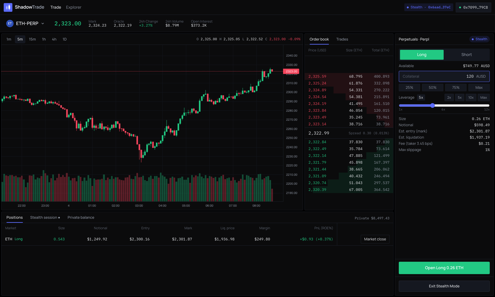
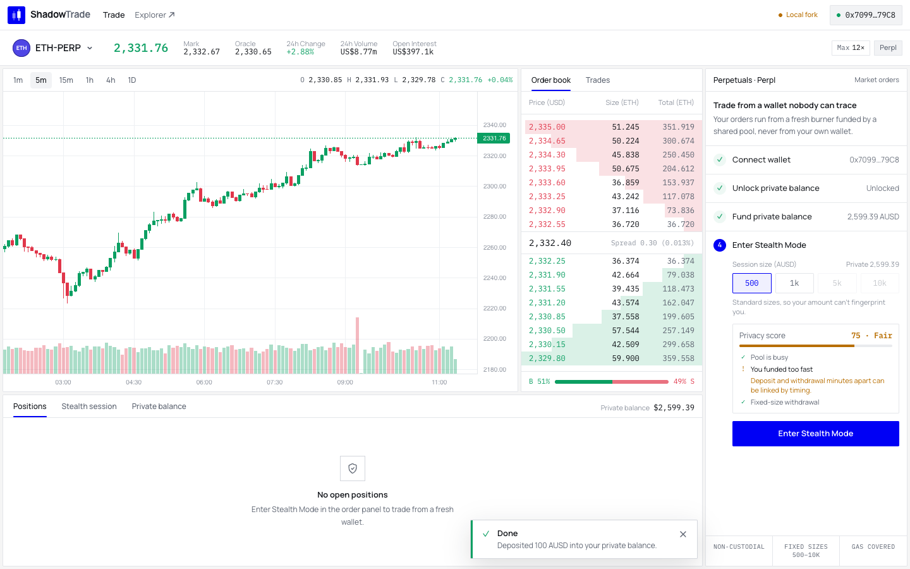
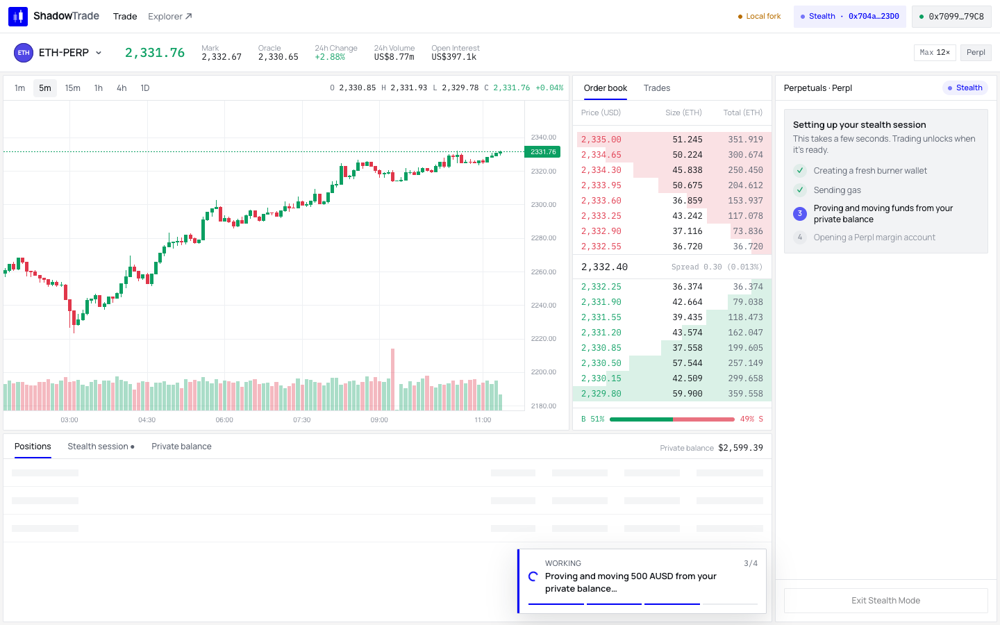
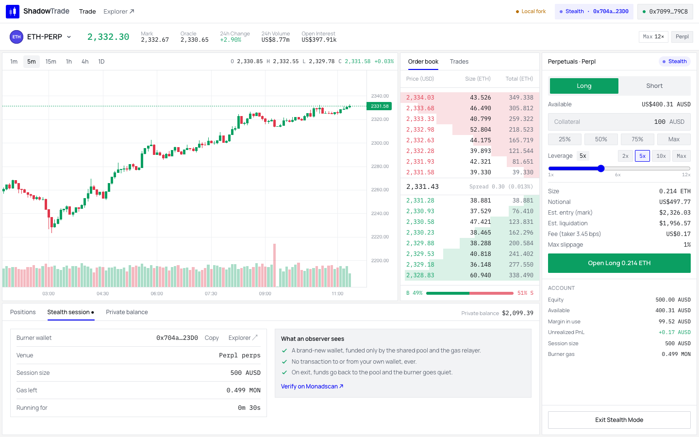
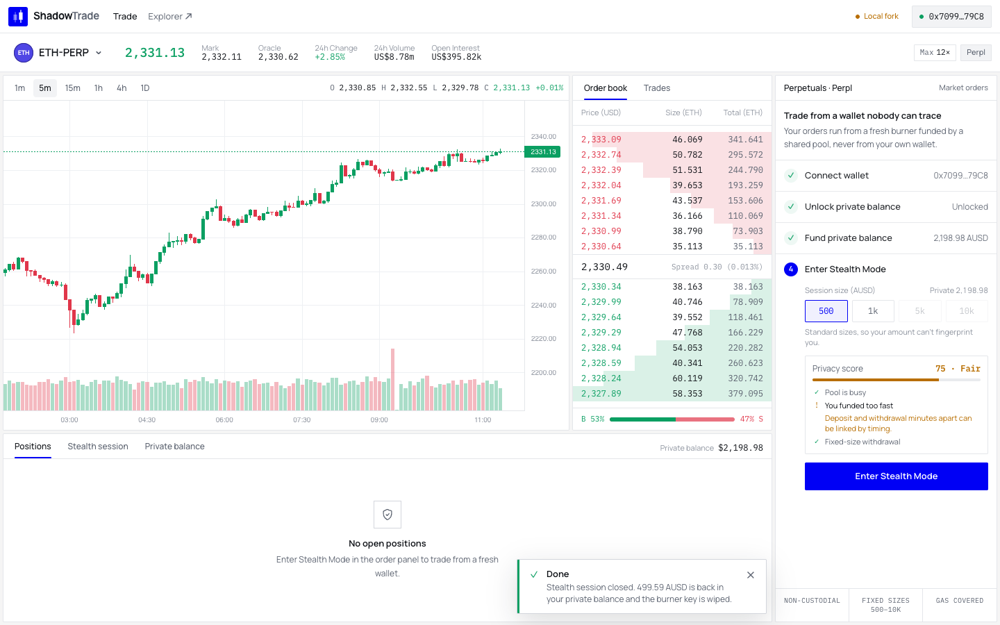

# ShadowTrade

**Incognito mode for traders on Monad.**

On public DEXs your wallet is a glass box: copy-bots follow your trades, liquidation hunters see your levels, and anyone can read your PnL. ShadowTrade lets you trade Perpl perps from a fresh burner wallet with **no on-chain link to your main wallet**. When you're done, the funds go back into a private balance and the burner key is wiped.

Existing solutions take hours per round trip. On Monad, ShadowTrade does it in **seconds**.



## How it works

```
[Main wallet] ──deposit──► [Private balance · 0xbow Privacy Pool]
                                   │  Enter Stealth: browser derives a burner key and
                                   │  builds a ZK proof; relayer submits it + drips gas
                                   ▼
                           [Burner wallet · no history]
                                   │  trade perps on Perpl
                                   ▼
                           [Close positions]
                                   │  Exit Stealth: burner deposits everything back
                                   ▼
                    [Private balance]   (burner key wiped)
```

1. **Deposit** funds from your main wallet into a ZK privacy pool.
2. **Enter Stealth Mode.** The browser generates a Groth16 proof (~3 s) that you own *some* approved note in the pool and withdraws a fixed amount to a brand-new burner. A relayer submits the transaction and funds the burner's gas, so your main wallet never touches it.
3. **Trade** on Perpl with leverage, live charts and an order book.
4. **Exit Stealth Mode.** Positions are closed, everything returns to the pool as a new private note, and the burner key is wiped.

To an observer: a new wallet, funded by a shared privacy pool, made some trades and returned the money. Nothing points back to you.

## Walkthrough

| | |
|---|---|
|  |  |
| **1. Pick a size.** Fixed amounts and a live privacy score before you enter. | **2. Enter Stealth.** Burner created, gas sent, ZK proof built in the browser. |
|  |  |
| **3. Trade.** Perps from the burner; the session tab shows what an observer sees. | **4. Exit.** 499.59 of 500 AUSD back in the private balance, burner key wiped. |

## Features

- **Pro trading terminal:** live candles, order book, recent trades, perps order ticket with leverage and liquidation price, positions table.
- **Private balance:** deposit and withdraw via [0xbow Privacy Pools](https://0xbow.io), deployed by us on Monad testnet.
- **One-click stealth sessions:** a guided 4-step flow (connect, deposit, pick size, enter stealth).
- **No stored secrets:** all keys and burners derive from one wallet signature. Your private balance and any open session can be recovered on any device, even after clearing browser data.
- **Privacy hygiene:** fixed funding sizes (500 / 1k / 5k / 10k) so amounts can't fingerprint you, relayer-funded gas, and a live **privacy score** (0–100) that warns when the anonymity set is too small.
- **Safe exits:** a session never wipes its key while funds are still on the burner.

## Why Monad

- **Speed:** ~400 ms blocks make the full deposit → stealth → trade → exit loop take seconds, including proof generation.
- **Cost:** spinning up a burner and running a full session costs a fraction of a cent.
- **Built for Monad's execution model:** gas limits are simulated and padded (Monad bills on gas limit), burner transactions respect the 3-block delayed state, and burners stay plain accounts to avoid the EIP-7702 reserve rule.

## What's live

| Component | Status |
|---|---|
| Perpl perps exchange (AUSD collateral) | Real Monad testnet contracts |
| 0xbow Privacy Pools (Entrypoint `0x4810…a798`, AUSD pool `0xf55a…Ea48`) | Deployed by us on Monad testnet, contracts unmodified, 0xbow trusted-setup circuits |
| Relayer and ASP (`/api/relay`, `/api/pool`) | Ours; ASP currently approves every deposit |

**Verified on live testnet:** stealth session ready in 17.5 s; 499.95 of 500 AUSD returned after a round trip with an ETH long (the 0.05 difference is Perpl fees).

## Tech stack

Next.js 16 · React 19 · viem · snarkjs / 0xbow SDK (in-browser Groth16) · Foundry · TradingView Lightweight Charts

```
contracts/   0xbow Privacy Pools (vendored), deploy script, Foundry tests
frontend/    Next.js app: landing page (/), terminal (/trade), relayer + ASP + Perpl proxy API routes
scripts/     Local Monad testnet fork setup
```

## Run it

**Prerequisites:** Node + pnpm, [Foundry](https://book.getfoundry.sh/), MetaMask.

```bash
# Option A: local fork of Monad testnet with real Perpl contracts (recommended)
scripts/fork.sh                          # terminal 1
scripts/fork-setup.sh <your-address>     # terminal 2: funds MON + AUSD, deploys pools if needed
```

Create `frontend/.env.local`:

```bash
RELAYER_PRIVATE_KEY=0x...
NEXT_PUBLIC_RPC_URL=http://127.0.0.1:8545     # or https://testnet-rpc.monad.xyz for live testnet
NEXT_PUBLIC_DEV_WALLET_KEY=0x...              # optional, fork only: "Use test wallet" button
```

```bash
cd frontend && pnpm install && pnpm dev
```

Open `http://localhost:3000` (landing) and `/trade` (terminal).

## Tests

```bash
cd contracts && forge test     # Privacy Pools deployment, deposits, ASP roots, relay
cd frontend && pnpm e2e        # full end-to-end flow against the fork
cd frontend && pnpm smoke:live # one real round trip on live testnet
```

The e2e suite runs the full flow (deposit, stealth, ETH and BTC positions, exit, private withdrawal, recovery from signature only) and checks that **9 of 9 abuse cases** are rejected, including double spends, forged proofs, redirected recipients and stale ASP roots.

## Limitations & next steps

- Market orders only; limit orders are next.
- The ASP approves all deposits. Production needs deposit screening plus a `ragequit` path for unapproved ones.
- Privacy is only as strong as the pool's anonymity set; the privacy score makes this visible.
- Single relayer key. Next: a decentralized relayer, per-session RPCs, splitting large orders across burners, and passkey login.

*Non-custodial: keys stay in your browser and we never hold funds.*

---

Built for **Monad Blitz Devcon Mumbai** · [Portal](https://blitz.devnads.com)
